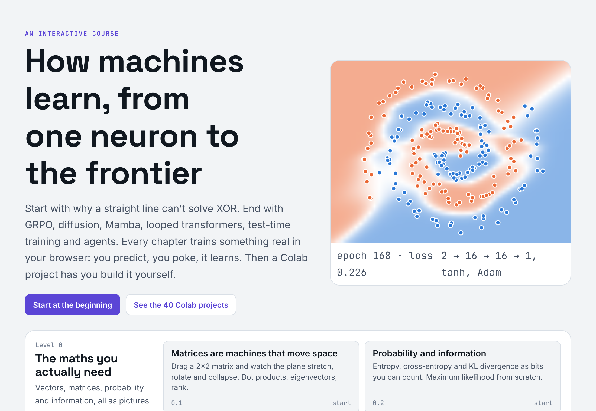
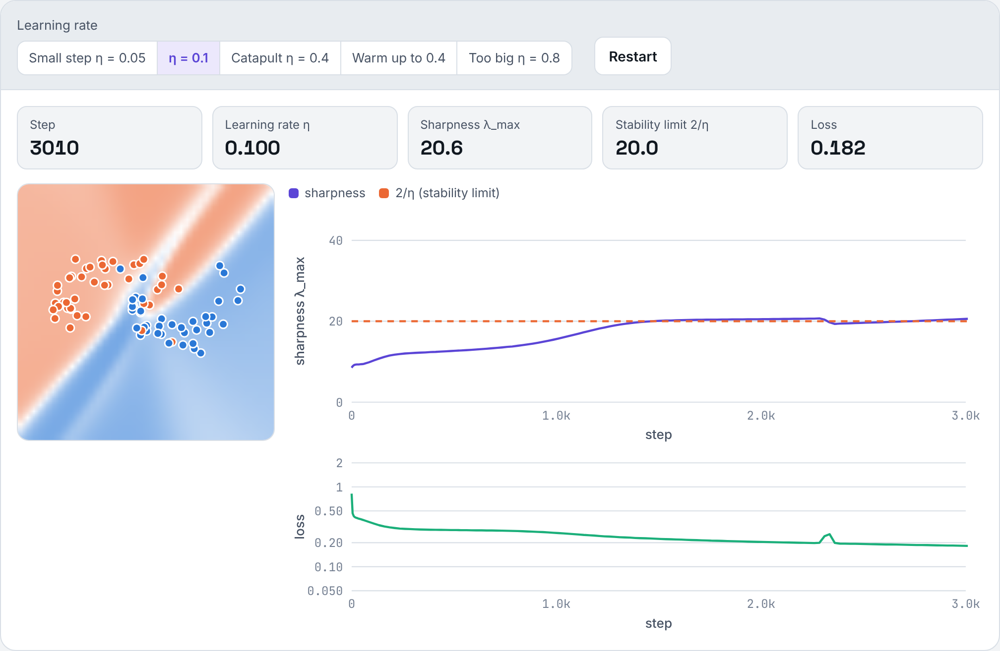
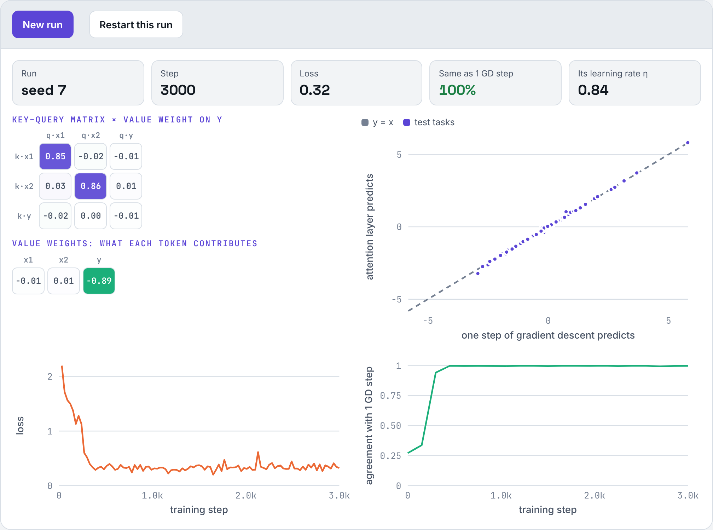
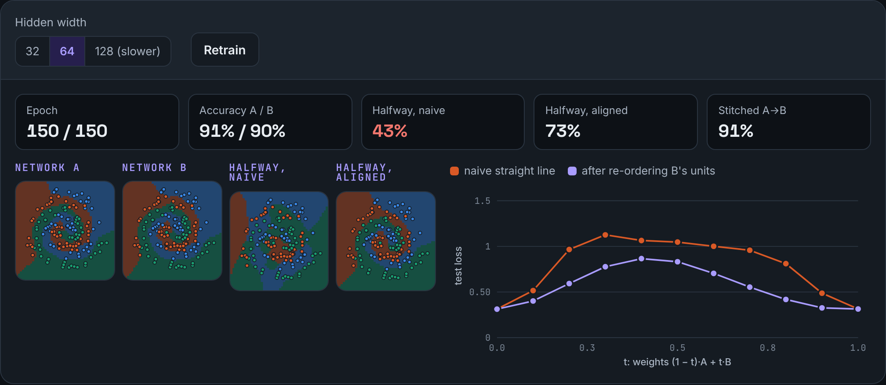
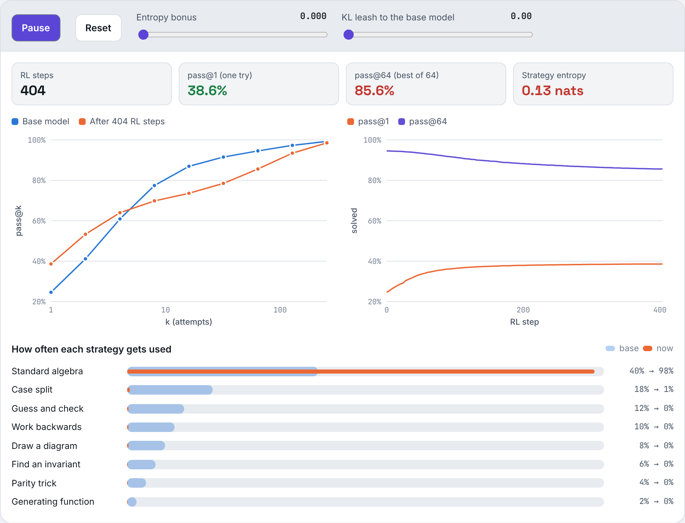
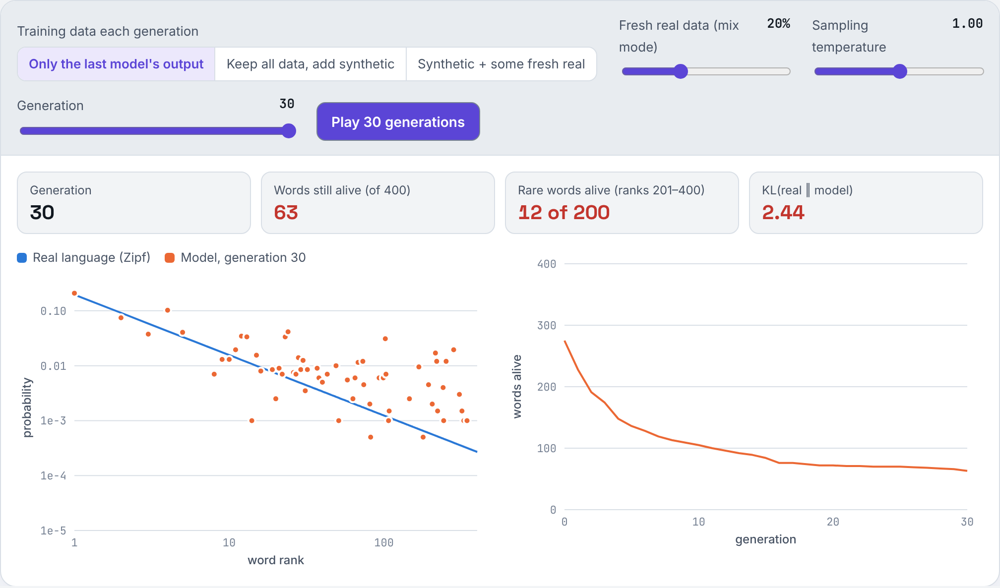

# AI Anatomy

How machines learn, from one neuron to the frontier. 104 interactive chapters that train real models in your browser, and 65 Colab projects where you build each idea yourself.



Every chapter runs a live simulation in plain JavaScript (no build step, no server-side compute): you predict what will happen, change a setting, and watch a network learn. Each chapter also has field notes on what works in practice, what the big runs found, what is still unknown, and deeper cuts with code. 45 chapters also step through a few lines of real code with real numbers, drawing every tensor as a stack of pixel cubes you can hover for the arithmetic.

| | |
|---|---|
|  |  |
| **The hidden laws of training.** Sharpness climbs until it hits 2/η, then stays there. | **Every way machines learn now.** Train an attention layer on regression tasks and watch it become one step of gradient descent. |
|  |  |
| **Different networks, same mind.** Two seeds look unrelated until their neurons are re-ordered. | **How machines see (and don't).** Puzzles a child solves that vision-language models still miss. |
|  |  |
| **What RL really does to a model.** pass@1 rises while pass@k falls: RL sharpens more than it teaches. | **Models eating their own outputs.** Each generation forgets more of the tail of the distribution. |

## The Architecture Studio

[`/studio`](studio.html) is a real transformer in 3D, drawn at its true proportions, that you open level by level (model › block › attention › one head) and change part by part. It has three modes:

- **Learn**: eleven levels that build a transformer one part at a time, from a bare lookup table to the modern Llama recipe, the KV cache and mixture of experts, with Neuro explaining why each part exists and checks that tick as you go. Each level asks you to guess first (answered with numbers from our own lab runs) and clears up a common mix-up. Clear a level to get three numbers to keep, then review them as flashcards.
- **Challenges**: real design problems (shrink the KV cache 4×, fit 100 users on one GPU, read 128k tokens cheaply, the best model for $500) checked live against the predictor.
- **Build**: start from Tiny GPT, GPT-2, GPT-3, Llama 2, Llama 3 8B, Mistral 7B or Mixtral 8×7B (exact parameter counts), ride the time machine from 2019 to 2024 and see what changed at each step, apply recipes, edit anything, pin a design to compare against (it stands next to yours in 3D), see where its parameters live, which devices it fits on at 16, 8 or 4 bits, how one H100's 80 GB fills up with chats, how its loss falls as it reads more, and save a picture of it.

Press ▶ **Watch a token** (or Space) to follow one token through the model stop by stop, with pause, step and speed controls. Inside an attention head it scans word by word; on the readout you can turn the temperature and pick the next word yourself. Earn stickers as you go.

Five panels: **Inspect** (what a part is and why it's there), **Predict** (what will happen before training, each line tagged exact / physics / law / rule of thumb / test it), **Speed** (what makes it faster on an H100 and what doesn't), **Test** (one click to a Colab run of your design against its baseline, then paste the result back to see if the prediction held, and colour the 3D blocks by the measured gradients) and **Design**.

## The curriculum

**0. The maths you actually need**: Matrices are machines that move space · Probability and information

**1. Why learning works**: Why not just write the rules? · Rolling downhill · The perceptron · XOR and the first AI winter · Backpropagation, by hand · Memorising vs understanding

**2. Classical machine learning**: Neighbours, trees and forests · Margins and the kernel trick · Finding structure without labels · Thinking like a Bayesian

**3. The deep learning toolkit**: Making deep nets trainable · Convolutions: how nets see · Meaning as geometry · Sequences and memory · Autoencoders and VAEs · Graph neural networks · Hopfield networks and Boltzmann machines

**4. Language models from scratch**: BPE: inventing tokens · Predict the next token · Attention · The transformer block · Long context · Scaling laws · Where the data comes from

**5. Reinforcement learning**: Reinforcement learning from zero · Q-learning and DQN · Search plus learning: AlphaZero

**6. From autocomplete to assistant**: Supervised fine-tuning · RLHF and PPO · GRPO and DPO · Alignment and reward hacking · Distillation, pruning and merging

**7. Model families**: Diffusion and flow matching · GANs and normalizing flows · Vision transformers and CLIP · Speech and audio models · State space models and Mamba · Mixture of experts · World models and robots

**8. Thinking, fast and slow**: Chain of thought and System 2 · Looped and recurrent-depth models · Test-time training

**9. From electrons to CUDA: why AI runs on GPUs**: What AI asks of the electrons · Why sand can switch · Voltage, current and the laws of a circuit · The transistor: a switch made of a field · How a chip is made: printing with light · From switches to arithmetic · Why memory is far and slow · The CPU: one thread, as fast as possible · From switches to languages · The power wall: why chips went wide · Why the GPU was invented · Design a GPU from the goal · CUDA: programming ten thousand threads · The software stack: from Python to machine code · One multiply, all the way down · The edges of physics: what's still unsolved

**10. Systems: training and serving at scale**: Numbers: fp32, bf16, fp8, int4 · Distributed training · GPU kernels and the roofline · Fast inference

**11. Agents**: Tool use, at the token level · Agent loops and the Ralph loop · Context engineering and memory · Evals: is it actually better?

**12. Research and the frontier**: Looking inside: superposition · How researchers improve models · Learning without forgetting · The deep cuts atlas · The frontier radar · What is intelligence?

**13. Reality check: what actually works**: Papers vs reality · The LLM recipe: what survived · Data beats architecture · Read a training run · Prompt, RAG, fine-tune or RL? · What it really costs

**14. Lab notebook: not in textbooks yet**: GPU kernels from first principles · Keeping big runs stable · How labs run experiments · What trained models actually do

**15. Frontier notebook: laws, theories and bets**: The hidden laws of training · Different networks, same mind · How humans decide what models do · Every way machines learn now · How machines see (and don't) · Intuitions from many runs · Theories I'd test with a cluster · Bets: predictions nobody has tested

**16. The hidden curriculum: notes from inside the models**: What RL really does to a model · Models eating their own outputs · Is that +2% real? · How long should a model think? · Notes from inside a language model · How models teach themselves · The cooldown: why loss drops at the end · Emergence: real, or the ruler? · Where progress comes from · Why models make things up · Facts are one-way streets · What I know but can't cite

## Colab projects

| Phase | Projects | |
|---|---|---|
| Model zoo, step by step | 8 | Zoo 1: the words and the data, Zoo 2: the linear family, Zoo 3: classic machine learning, Zoo 4: learning without labels, Zoo 5: neural networks by architecture, Zoo 6: generative models, Zoo 7: the ways a model can learn, Zoo 8: picking a model, and the dilemmas |
| Foundations by hand | 4 | Linear regression three ways, Write an autograd engine, MNIST: MLP vs CNN, with ablations, Trees and gradient boosting from scratch |
| Representations and generation | 5 | Autoencoder and VAE on MNIST, Diffusion and flow matching, GANs and mode collapse, Graph neural network from scratch, Hopfield networks to attention |
| Build a GPT | 4 | Byte-level BPE tokenizer, GPT from scratch, Measure your own scaling law, Mixture-of-experts layer |
| Post-training | 6 | SFT with LoRA written by hand, REINFORCE to PPO on CartPole, Q-learning to DQN, AlphaZero on tic-tac-toe, Reward model and DPO, GRPO from scratch |
| New architectures and thinking longer | 12 | Selective scan from scratch, Recurrent depth: think longer at test time, The looped transformer, Test-time training layers, Where am I? Positions and length, Shrinking the KV cache, A diffusion language model, Speculative decoding, Your first Triton kernels, Distil, prune and quantise, Model merging and task arithmetic, Where the GPU memory goes |
| Agents, interpretability and research | 6 | Agent loop and Ralph loop with Claude, Superposition and sparse autoencoders, Grokking modular addition, Ablation lab: what matters in a small GPT, Data vs model size, Catastrophic forgetting |
| Lab notebook | 5 | GPU kernels step by step, Hyperparameters that transfer: μP, A scaling ladder, A sleeper-agent model organism, Reward hacking and the monitor |
| Capstones | 3 | Train a reasoning model with GRPO, GPT-2 speedrun: Muon vs AdamW, Find the features inside GPT-2 |
| Hidden curriculum | 12 | Does RL teach, or only sharpen?, Model collapse with a real language model, Error bars on evals, with real models, How long should a model think?, Test what a model says about itself, Can a model teach itself?, The cooldown, measured, Emergence or mirage?, Testing my conjectures, One-way facts and confident guesses, From electrons to CUDA, measured, Studio lab: test your design |

Every notebook runs end to end on a CPU in a quick mode (`QUICK=1`), with offline fallbacks when Hugging Face or an API key isn't available. The expected results quoted on the site were measured from these notebooks; where a run needs a GPU we didn't have, the result is labelled as a prediction.

## Honesty conventions

- Results are either measured (by these notebooks or simulations), quoted from published work with a citation, or labelled as a prediction, intuition or bet with a confidence.
- When a toy fails to show a published effect, the chapter says so and explains why it should hold at scale.

## Run it locally

```bash
node serve.mjs            # http://localhost:4173
node test/smoke.mjs       # loads every page in Chromium and fails on any error
```

Notebooks are written as `notebooks/src/*.py` with `# %%` cells and built with `python tools/build_notebooks.py`; `tools/test_notebooks.sh` runs them in quick mode.

## Deploy

It's a static site. On Vercel: import the repository, choose the "Other" framework preset, leave the build command empty, deploy. `vercel.json` already maps `/learn?c=…` and the other clean URLs.
