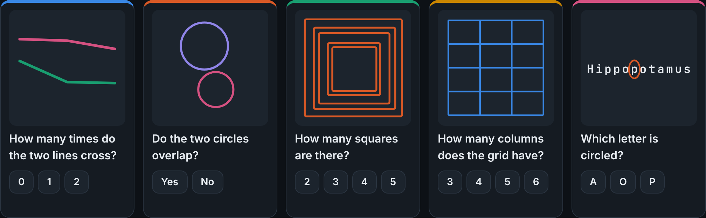

# AI Anatomy

How machines learn, from one neuron to the frontier. 76 interactive chapters that train real models in your browser, and 40 Colab projects where you build each idea yourself.


Every chapter runs a live simulation in plain JavaScript (no build step, no server-side compute): you predict what will happen, change a setting, and watch a network learn. Each chapter also has field notes on what works in practice, what the big runs found, what is still unknown, and deeper cuts with code.

| | |
|---|---|
|  |  |
| **The hidden laws of training.** Sharpness climbs until it hits 2/η, then stays there. | **Every way machines learn now.** Train an attention layer on regression tasks and watch it become one step of gradient descent. |
|  |  |
| **Different networks, same mind.** Two seeds look unrelated until their neurons are re-ordered. | **How machines see (and don't).** Puzzles a child solves that vision-language models still miss. |

## The curriculum

**0. The maths you actually need**: Matrices are machines that move space · Probability and information

**1. Why learning works**: Why not just write the rules? · Rolling downhill · The perceptron · XOR and the first AI winter · Backpropagation, by hand · Memorising vs understanding

**2. Classical machine learning**: Neighbours, trees and forests · Margins and the kernel trick · Finding structure without labels · Thinking like a Bayesian

**3. The deep learning toolkit**: Making deep nets trainable · Convolutions: how nets see · Meaning as geometry · Sequences and memory · Autoencoders and VAEs · Graph neural networks · Hopfield networks and Boltzmann machines

**4. Language models from scratch**: BPE: inventing tokens · Predict the next token · Attention · The transformer block · Long context · Scaling laws · Where the data comes from

**5. Reinforcement learning**: Reinforcement learning from zero · Q-learning and DQN · Search plus learning: AlphaZero

**6. From autocomplete to assistant**: Supervised fine-tuning · RLHF and PPO · GRPO and DPO · Alignment and reward hacking · Distillation, pruning and merging

**7. Model families**: Diffusion and flow matching · GANs and normalizing flows · Vision transformers and CLIP · Speech and audio models · State space models and Mamba · Mixture of experts · World models and robots

**8. Thinking, fast and slow**: Chain of thought and System 2 · Looped and recurrent-depth models · Test-time training

**9. Systems: training and serving at scale**: Numbers: fp32, bf16, fp8, int4 · Distributed training · GPU kernels and the roofline · Fast inference

**10. Agents**: Tool use, at the token level · Agent loops and the Ralph loop · Context engineering and memory · Evals: is it actually better?

**11. Research and the frontier**: Looking inside: superposition · How researchers improve models · Learning without forgetting · The deep cuts atlas · The frontier radar · What is intelligence?

**12. Reality check: what actually works**: Papers vs reality · The LLM recipe: what survived · Data beats architecture · Read a training run · Prompt, RAG, fine-tune or RL? · What it really costs

**13. Lab notebook: not in textbooks yet**: GPU kernels from first principles · Keeping big runs stable · How labs run experiments · What trained models actually do

**14. Frontier notebook: laws, theories and bets**: The hidden laws of training · Different networks, same mind · How humans decide what models do · Every way machines learn now · How machines see (and don't) · Intuitions from many runs · Theories I'd test with a cluster · Bets: predictions nobody has tested

## Colab projects

| Phase | Projects | |
|---|---|---|
| Foundations by hand | 4 | Linear regression three ways, Write an autograd engine, MNIST: MLP vs CNN, with ablations, Trees and gradient boosting from scratch |
| Representations and generation | 5 | Autoencoder and VAE on MNIST, Diffusion and flow matching, GANs and mode collapse, Graph neural network from scratch, Hopfield networks to attention |
| Build a GPT | 4 | Byte-level BPE tokenizer, GPT from scratch, Measure your own scaling law, Mixture-of-experts layer |
| Post-training | 6 | SFT with LoRA written by hand, REINFORCE to PPO on CartPole, Q-learning to DQN, AlphaZero on tic-tac-toe, Reward model and DPO, GRPO from scratch |
| New architectures and thinking longer | 7 | Selective scan from scratch, Recurrent depth: think longer at test time, Test-time training layers, Speculative decoding, Your first Triton kernels, Distil, prune and quantise, Where the GPU memory goes |
| Agents, interpretability and research | 6 | Agent loop and Ralph loop with Claude, Superposition and sparse autoencoders, Grokking modular addition, Ablation lab: what matters in a small GPT, Data vs model size, Catastrophic forgetting |
| Lab notebook | 5 | GPU kernels step by step, Hyperparameters that transfer: μP, A scaling ladder, A sleeper-agent model organism, Reward hacking and the monitor |
| Capstones | 3 | Train a reasoning model with GRPO, GPT-2 speedrun: Muon vs AdamW, Find the features inside GPT-2 |

Every notebook runs end to end on a CPU in a quick mode (`QUICK=1`), with offline fallbacks when Hugging Face or an API key isn't available. The expected results quoted on the site were measured from these notebooks; where a run needs a GPU we didn't have, the result is labelled as a prediction.

## Honesty conventions

- Results are either measured (by these notebooks or simulations), quoted from published work with a citation, or labelled as a prediction, intuition or bet with a confidence.
- When a toy fails to show a published effect, the chapter says so and explains why it should hold at scale.

## Run it locally

```bash
node serve.mjs            # http://localhost:4173
node test/smoke.mjs       # loads every page in Chromium and fails on any error
```

Notebooks are written as `notebooks/src/*.py` with `# %%` cells and built with `python tools/build_notebooks.py`; `tools/test_notebooks.sh` runs them in quick mode.

## Deploy

It's a static site. On Vercel: import the repository, choose the "Other" framework preset, leave the build command empty, deploy. `vercel.json` already maps `/learn?c=…` and the other clean URLs.
